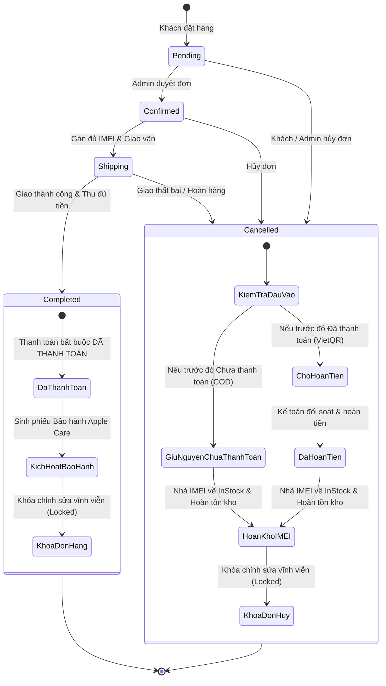

# TÀI LIỆU NGHIỆP VỤ: RÀNG BUỘC TRẠNG THÁI ĐƠN HÀNG & DÒNG TIỀN THANH TOÁN (AAR STATE MACHINE)

> **Hệ thống:** Chuỗi Bán lẻ Ủy quyền Apple Reseller - BomChelsea Enterprise  
> **Áp dụng cho:** Quản lý Chi tiết Đơn hàng (`OrderDetail`), Kế toán & Xuất kho (`AdminController`), Khách hàng Storefront (`OrderController`)  
> **Cập nhật ngày:** 01/11/2026  

---

## MỤC LỤC
1. [Tổng quan & Bối cảnh bài toán](#1-tổng-quan--bối-cảnh-bài-toán)
2. [Chi tiết các yêu cầu & Lỗ hổng nghiệp vụ đã xử lý](#2-chi-tiết-các-yêu-cầu--lỗ-hổng-nghiệp-vụ-đã-xử-lý)
3. [Ma trận quy chuẩn Trạng thái Đơn hàng & Thanh toán (State Matrix)](#3-ma-trận-quy-chuẩn-trạng-thái-đơn-hàng--thanh-toán-state-matrix)
4. [Sơ đồ luồng chuyển dịch trạng thái (State Diagram)](#4-sơ-đồ-luồng-chuyển-dịch-trạng-thái-state-diagram)
5. [Chi tiết triển khai kỹ thuật (Frontend & Backend)](#5-chi-tiết-triển-khai-kỹ-thuật-frontend--backend)
6. [Kịch bản hướng dẫn Test & Demo cho Thầy Cô](#6-kịch-bản-hướng-dẫn-test--demo-cho-thầy-cô)

---

## 1. TỔNG QUAN & BỐI CẢNH BÀI TOÁN

Trong một hệ thống bán lẻ thiết bị giá trị cao như Apple Reseller (mỗi sản phẩm từ 20 đến 45 triệu VNĐ), **Trạng thái Đơn hàng (OrderStatus)** và **Trạng thái Thanh toán (PaymentStatus)** không thể vận hành độc lập, rời rạc. Nếu không có các ràng buộc chặt chẽ, hệ thống sẽ rơi vào các lỗ hổng dòng tiền nghiêm trọng:
- Đơn hàng đã giao máy thành công, kích hoạt bảo hành Apple Care nhưng tiền lại ghi nhận "Chưa thanh toán" (thất thoát doanh thu).
- Đơn hàng đang đi giao nhưng kế toán lại ghi nhận "Đã hoàn tiền" (mâu thuẫn logic kế toán).
- Đơn hàng hủy khi khách đã chuyển khoản trước bị treo tiền, không ghi nhận cần hoàn lại.

---

## 2. CHI TIẾT CÁC YÊU CẦU & LỖ HỔNG NGHIỆP VỤ ĐÃ XỬ LÝ

Nội dung các yêu cầu được giải quyết bao gồm 4 bài toán cốt lõi:

### ⚡ Yêu cầu 1: Ràng buộc Đơn hoàn tất bắt buộc phải "Đã thanh toán"
- **Vấn đề ban đầu:** Admin có thể chọn đơn hàng sang *"Hoàn tất giao hàng"* trong khi mục thanh toán vẫn để *"Chưa thanh toán"*.
- **Quy chuẩn AAR:**
  - Khi đơn sang `Completed`, khách đã nhận máy và hệ thống đã kích hoạt Bảo hành điện tử chính hãng 12 tháng (`Warranties`).
  - Dù là hình thức **Chuyển khoản / VietQR** (trả trước) hay **COD - Thu hộ tiền mặt** (khi giao thành công, shipper đã cầm tiền mặt của khách) thì dòng tiền đều đã thu đủ.
- **Giải pháp:**
  - Frontend: Khi chọn `Hoàn tất giao hàng`, dropdown Thanh toán **tự động chuyển sang "Đã thanh toán"**, khóa không cho chọn "Chưa thanh toán".
  - Backend: Trong `FulfillOrder`, tự động chuẩn hóa `PaymentStatus = "Đã thanh toán"` khi đơn là `Completed`.

---

### ⚡ Yêu cầu 2: Xử lý Hủy đơn hàng giữa "Khách đã thanh toán" vs "Khách chưa thanh toán"
- **Vấn đề đặt ra:** *"Khi hủy đơn mà trước đó đã thanh toán thì chuyển sang Chờ hoàn tiền, vậy lỡ khách chưa thanh toán thì sao?"*
- **Quy chuẩn AAR:**
  - **Trường hợp A (Khách ĐÃ thanh toán trước qua VietQR / Thẻ):** Tiền của khách đang nằm trong tài khoản công ty $\rightarrow$ Khi hủy đơn, hệ thống **tự động chuyển sang "Chờ hoàn tiền" (Pending Refund)** để kế toán làm lệnh chuyển khoản trả lại tiền cho khách.
  - **Trường hợp B (Khách CHƯA thanh toán - Đơn COD hoặc chưa chuyển tiền):** Cửa hàng chưa thu đồng nào của khách $\rightarrow$ **Vẫn giữ nguyên "Chưa thanh toán"** (tuyệt đối không chuyển sang Chờ hoàn tiền vì không có tiền để hoàn).
  - Cả hai trường hợp hủy đơn đều kích hoạt cơ chế kho vận:
    1. Hoàn lại số lượng tồn kho: `Product.Quantity += Quantity`.
    2. Giải phóng mã IMEI giữ chỗ: Chuyển từ `Reserved` về `InStock` để bán cho khách khác.

---

### ⚡ Yêu cầu 3: Khóa không cho chọn "Chờ hoàn tiền" & "Đã hoàn tiền" khi đơn đang hoạt động
- **Vấn đề ban đầu:** Khi đơn đang Chờ duyệt, Đã duyệt, Đang giao hoặc Đã thanh toán, dropdown Thanh toán vẫn hiện "Chờ hoàn tiền" và "Đã hoàn tiền", gây nhầm lẫn nếu bấm chọn.
- **Quy chuẩn AAR:**
  - Chỉ duy nhất khi đơn hàng ở trạng thái **"Hủy đơn hàng" (Cancelled)** thì mới phát sinh nhu cầu hoàn tiền.
  - Khi đơn hàng đang trong luồng vận hành (`Pending`, `Confirmed`, `Shipping`, `Completed`), chỉ được phép chọn giữa: **"Chưa thanh toán"** hoặc **"Đã thanh toán"**.
- **Giải pháp:**
  - Frontend: Vô hiệu hóa (`disabled`) 2 tùy chọn *"Chờ hoàn tiền"* và *"Đã hoàn tiền"*. Chỉ khi chuyển `OrderStatus = Cancelled` thì 2 tùy chọn này mới sáng lên.
  - Backend: Chặn đứng nếu `toStatus != "Cancelled"` mà lại gửi kèm `PaymentStatus` là *"Chờ hoàn tiền"* hoặc *"Đã hoàn tiền"*.

---

### ⚡ Yêu cầu 4: Ràng buộc IMEI trước khi xuất kho & giao hàng
- **Quy chuẩn AAR:** Mỗi chiếc iPhone xuất bán đều gắn liền với 1 mã IMEI chuẩn 15 chữ số. Không thể chuyển trạng thái sang `Shipping` (Đang giao) hoặc `Completed` (Hoàn tất) nếu chưa gán đủ 100% số lượng mã IMEI cho toàn bộ máy trong đơn hàng.
- **Giải pháp:** Kiểm tra số lượng IMEI khớp với tổng số máy ở cả Frontend (Client form submit) và Backend (`FulfillOrder`).

---

## 3. MA TRẬN QUY CHUẨN TRẠNG THÁI ĐƠN HÀNG & THANH TOÁN (STATE MATRIX)

| Trạng thái Đơn hàng (`OrderStatus`) | Trạng thái Thanh toán HỢP LỆ | Trạng thái BỊ KHÓA / CẤM | Hành động tự động của Hệ thống |
| :--- | :--- | :--- | :--- |
| **Pending** *(Chờ duyệt)* | • Chưa thanh toán (COD / QR chờ quét) • Đã thanh toán (Đã quét QR xong) | ❌ Chờ hoàn tiền ❌ Đã hoàn tiền | Khóa 2 option hoàn tiền trên dropdown. |
| **Confirmed** *(Đã duyệt)* | • Chưa thanh toán (Đơn COD) • Đã thanh toán (Đơn Online) | ❌ Chờ hoàn tiền ❌ Đã hoàn tiền | Chuẩn bị hàng, chờ gán mã IMEI. |
| **Shipping** *(Đang giao hàng)* | • Chưa thanh toán (Shipper đang đi thu hộ COD) • Đã thanh toán (Đã trả trước) | ❌ Chờ hoàn tiền ❌ Đã hoàn tiền | Bắt buộc đã gán đủ 100% mã IMEI. Khóa 2 option hoàn tiền. |
| **Completed** *(Hoàn tất giao hàng)* | • **Đã thanh toán** *(Bắt buộc)* | ❌ Chưa thanh toán ❌ Chờ hoàn tiền ❌ Đã hoàn tiền | Tự động đồng bộ `PaymentStatus = Đã thanh toán`. Tự động kích hoạt Bảo hành điện tử Apple Care. Khóa chỉnh sửa. |
| **Cancelled** *(Hủy đơn hàng)* | • **Chưa thanh toán** *(Nếu là đơn COD)* • **Chờ hoàn tiền** *(Nếu đã thanh toán online)* • **Đã hoàn tiền** *(Kế toán đã chuyển trả)* | ❌ Đã thanh toán *(Không được bỏ quên khách)* | Tự động hoàn lại số lượng tồn kho `Quantity += item.Quantity`. Tự động nhả mã IMEI giữ chỗ về `InStock`. Khóa chỉnh sửa. |

---

## 4. SƠ ĐỒ LUỒNG CHUYỂN DỊCH TRẠNG THÁI (STATE DIAGRAM)

---

## 5. CHI TIẾT TRIỂN KHAI KỸ THUẬT (FRONTEND & BACKEND)

### 5.1. Tệp Razor View: `Areas/Admin/Views/Admin/OrderDetail.cshtml`
- **Khởi tạo trạng thái ban đầu:**  
  Thuộc tính `disabled="@(!isCancelled)"` được gắn trực tiếp vào các thẻ `<option value="Chờ hoàn tiền">` và `<option value="Đã hoàn tiền">`.
- **Hàm JavaScript `syncStatusRules()`:**  
  Lắng nghe sự kiện `change` trên cả `orderStatusSelect` và `paymentStatusSelect`:
  - Khi chọn `Completed`: Tự động gán `paymentStatusSelect.value = 'Đã thanh toán'` và kích hoạt khung ghi chú màu xanh chuẩn AAR.
  - Khi chọn `Cancelled`: Mở khóa 2 tùy chọn hoàn tiền. Nếu trước đó là `Đã thanh toán` $\rightarrow$ Tự động chuyển sang `Chờ hoàn tiền`. Nếu trước đó là `Chưa thanh toán` $\rightarrow$ Giữ nguyên và hiển thị thông báo xám kho vận.
  - Khi đổi `paymentStatusSelect` về `Chưa thanh toán` khi đơn đang `Completed` $\rightarrow$ Alert cảnh báo và tự hoàn tác về `Đã thanh toán`.
- **Form Submit Guard:**  
  Chặn submit nếu phát hiện:
  1. Đơn `Completed` mà thanh toán là `Chưa thanh toán`.
  2. Đơn không phải `Cancelled` mà chọn `Chờ hoàn tiền` / `Đã hoàn tiền`.
  3. Đơn `Shipping` / `Completed` mà chưa gán đủ IMEI hoặc trùng lặp IMEI.

### 5.2. Controller Admin: `Areas/Admin/Controllers/AdminController.cs`
- **Action `FulfillOrder`:**
  - Kiểm tra số lượng IMEI hợp lệ: `validSelectedCount >= totalRequiredUnits`.
  - Kiểm tra dòng tiền hoàn tất:  
    `if (toStatus == "Completed" && paymentStatus != "Đã thanh toán") paymentStatus = "Đã thanh toán";`
  - Kiểm tra dòng tiền hủy:  
    `if (toStatus == "Cancelled" && order.PaymentStatus == "Đã thanh toán") paymentStatus = "Chờ hoàn tiền";`
  - Chặn chọn hoàn tiền sai:  
    `if (toStatus != "Cancelled" && (paymentStatus == "Chờ hoàn tiền" || paymentStatus == "Đã hoàn tiền")) return Error;`
  - Kích hoạt bảo hành điện tử chính hãng trong bảng `Warranties` khi sang `Shipping`/`Completed`.
  - Tự động hoàn kho và chuyển trạng thái IMEI về `InStock` khi sang `Cancelled`.

### 5.3. Controller Khách hàng: `Controllers/OrderController.cs`
- **Action `CancelOrder`:**  
  Khi khách hàng thành viên tự bấm nút Hủy đơn ở trang Storefront:
  - Nếu `order.PaymentStatus == "Đã thanh toán"` $\rightarrow$ Tự động chuyển sang `"Chờ hoàn tiền"`.
  - Hoàn trả số lượng tồn kho `Product.Quantity` và giải phóng IMEI giữ chỗ.

---

## 6. KỊCH BẢN HƯỚNG DẪN TEST & DEMO CHO THẦY CÔ

Khi trình bày đồ án trước Hội đồng chấm thi, bạn có thể thực hiện tuần tự 3 kịch bản thực tế sau:

### Kịch bản 1: Xuất kho Hoàn tất đơn hàng (Fulfillment Flow)
1. Mở đơn hàng `Pending` hoặc `Confirmed`.
2. Chưa quét mã IMEI mà cố tình chọn **"Hoàn tất giao hàng"** $\rightarrow$ Hệ thống lập tức chặn lại và yêu cầu quét đủ IMEI.
3. Quét hoặc chọn đủ mã IMEI cho các máy trong đơn.
4. Chọn **"Hoàn tất giao hàng"** $\rightarrow$ Thầy sẽ thấy dropdown Thanh toán **tự động chuyển thành "Đã thanh toán"**, hiện thông báo chuẩn AAR màu xanh lá.
5. Bấm Lưu $\rightarrow$ Hệ thống chuyển đơn sang Hoàn tất, kích hoạt phiếu Bảo hành Apple Care 12 tháng và **khóa toàn bộ form** không cho sửa đổi nữa.

### Kịch bản 2: Hủy đơn COD chưa thanh toán (COD Cancellation)
1. Mở một đơn hàng COD đang ở trạng thái `Pending` (Thanh toán: "Chưa thanh toán").
2. Chọn Trạng thái đơn hàng sang **"Hủy đơn hàng"**.
3. Thầy sẽ thấy Trạng thái thanh toán **vẫn giữ nguyên là "Chưa thanh toán"** (không bị nhảy bậy sang Chờ hoàn tiền), đồng thời xuất hiện ghi chú màu xám: *Không phát sinh hoàn tiền, hệ thống tự động hoàn tồn kho và giải phóng mã IMEI*.

### Kịch bản 3: Hủy đơn VietQR đã thanh toán online (Refund Policy)
1. Mở một đơn hàng đã quét mã VietQR thành công (Thanh toán: "Đã thanh toán").
2. Chọn Trạng thái đơn hàng sang **"Hủy đơn hàng"**.
3. Thầy sẽ thấy dropdown Thanh toán **tự động nhảy sang "Chờ hoàn tiền"** kèm thông báo màu đỏ yêu cầu chuyển cho kế toán xử lý.
4. Lúc này mở dropdown Thanh toán, hai mục "Chờ hoàn tiền" và "Đã hoàn tiền" mới được mở khóa để kế toán thao tác.

